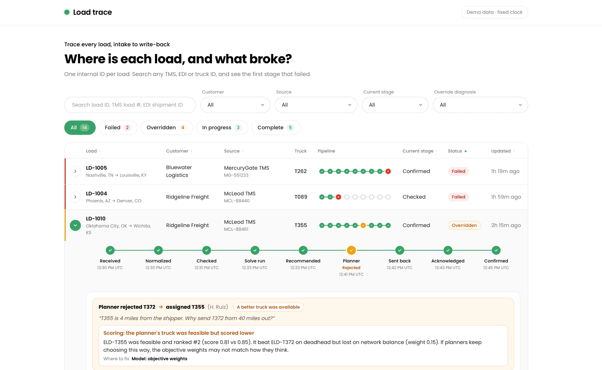

# Load trace prototype

A small working version of the Scenario 2 idea: every load gets one internal ID, every stage
appends an event to that load's timeline, and one view shows where each load is and which
stage failed first.



*The load trace view. LD-1010 is expanded: the planner rejected the recommended truck, and the
diagnosis traces it back to the solver's objective weights.*

## Build and run

The app has two parts, each run in its own terminal:

- **API:** Python + FastAPI on port 8000
- **Web page:** TypeScript + React, served by Vite on port 5173. It forwards `/api` calls to the API.

### 1. Install the prerequisites (once)

| Tool | Version | Install |
|------|---------|---------|
| [uv](https://docs.astral.sh/uv/) | any recent | `curl -LsSf https://astral.sh/uv/install.sh \| sh` (installs Python 3.12 for you on first run) |
| [Node.js](https://nodejs.org/) | 18 or newer | from nodejs.org, or `brew install node` |
| Git | any | to clone the repo |

### 2. Get the code

```bash
git clone https://github.com/speby/optimal-dynamics-load-trace.git
cd optimal-dynamics-load-trace
```

### 3. Start the API (terminal 1)

```bash
cd backend
uv sync
uv run uvicorn loadtrace.api:app --reload --port 8000
```

Wait for `Application startup complete`. To check it's up, open
http://localhost:8000/api/loads; you should see JSON for 14 loads.

### 4. Start the web page (terminal 2)

```bash
cd frontend
npm install
npm run dev
```

### 5. Open it

Go to **http://localhost:5173**. You should see 14 loads: 2 failed, 4 overridden, 3 in progress, 5 complete.
Click any row to expand it.

To stop, press `Ctrl+C` in each terminal. The data is made up and rebuilt each time the API
starts, so there's nothing to reset.

### Run the tests

```bash
cd backend
uv run pytest -q
```

### Build for production (optional)

```bash
cd frontend
npm run build
```

This typechecks the code and writes a static site to `frontend/dist/`. It still needs the API
running behind `/api`.

### If something goes wrong

| What you see | What to do |
|--------------|------------|
| "Couldn't load traces… Is the backend running on :8000?" | The API isn't running. Start it (step 3). |
| "Couldn't load traces: API 500…" | The API is running but hit an error. Check the traceback in terminal 1. |
| `Address already in use` | Something else is on port 8000 or 5173. Stop it, or find it with `lsof -i :8000`. |
| `uv: command not found` | Install uv (step 1), then open a new terminal. |

## How it maps to the Scenario 2 design

| Design (production)                         | Prototype                                          |
|---------------------------------------------|----------------------------------------------------|
| DynamoDB timeline, PK load ID, SK event time | SQLite `events` table, append-only (`store.py`)    |
| GSI on external IDs                          | `external_ids` table: TMS number, EDI control number, ELD unit |
| Load trace view                              | React table, search by any ID, filter, sort (`frontend/src/App.tsx`, `LoadTable.tsx`, `Stepper.tsx`) |
| Current status                               | Never stored; derived from events on every read (`trace.py`) |

## The two planted failures

| Load    | Failure                                | Kind    | How it's caught |
|---------|----------------------------------------|---------|-----------------|
| LD-1004 | ELD location 6h old                    | Input   | Freshness check writes a `checked` **fail event**; the load is quarantined and never reaches the solver. |
| LD-1005 | TMS acknowledged, never confirmed      | Output  | **No event says it failed.** A timeout rule sees `acknowledged` with no `confirmed` after 15 min. |

The second kind is the interesting one: some failures only show up as a missing event. Here the
rule runs when the page is read; in production it would be a scheduled job that writes a timeout
event and alerts.

## Planner overrides and the solver trace

A load can go through every stage cleanly and still get the wrong answer: the planner rejects
the recommendation and assigns a different truck. These loads get their own status,
**Overridden**, and a diagnosis worked out from the solver's own trace.

**What the solver records.** Each solve writes a *decision record* containing:
- model version, objective-weights version and constraint-set version
- the input snapshot
- the elimination funnel (how many trucks each hard constraint removed)
- every candidate truck with its score broken down by component
- the winning truck's margin over the runner-up
- input warnings, such as stale hours-of-service data

The timeline's `solve_run` event carries only a summary and a pointer to the record
(`s3://decision-records/…`). In the prototype a SQLite table stands in for S3; in production this
keeps DynamoDB items small. With a pinned model version and an immutable snapshot, any solve can
also be replayed later.

**What the planner records.** A one-click reason code, an optional note, and the truck they
assigned instead.

**The diagnosis** comes from where the planner's truck sat in the solver's view
(`backend/loadtrace/diagnose.py`):

| Load    | Where the planner's truck was | Diagnosis | Where to fix |
|---------|-------------------------------|-----------|--------------|
| LD-1014 | Not in the fleet snapshot at all | Data gap | Fleet feed |
| LD-1013 | Ruled out by hours-of-service, using a 4h22m-old reading | Constraint or input | Hours-of-service feed (stale input, not the rule) |
| LD-1010 | Feasible, ranked #2: less deadhead, worse network balance | Scoring | Objective weights |
| LD-1003 | Feasible, ranked #2; reason was a customer requirement | Missing context | Capture it as data |

The recommendation is computed: the top-scoring feasible truck under `OBJECTIVE_WEIGHTS`. So
changing the weights changes the outcome. Set deadhead to 0.50 and network balance to 0.00, and
the solver picks LD-1010's truck itself; the override goes away.

**Soft warnings.** Checks that pass but are close to a limit are flagged. LD-1013's truck had a
location ping 25 minutes old against a 30-minute limit. So an override can be traced back to
marginal inputs even when every stage is green.

In the page, expanding a load shows a **Solver decision** panel with:
- the versions
- the funnel
- the top candidates with score bars, plus the planner's pick, even if it was ruled out or never
  considered

For overrides, the panel opens with the planner's reason and the diagnosis. Filter by diagnosis
with **Override diagnosis**.

## Seed data

14 loads for two carrier customers, from four sources: two TMSs (McLeod, MercuryGate) and two
shippers' EDI 204 tender feeds. Each load carries only its source's IDs:
- a TMS load number, **or**
- an EDI shipment ID plus control number

The ELD unit is the truck's ID. It's linked when a truck is checked/assigned, so searching a
truck (`ELD-T204`) returns every load it hauled.

Besides the two failures, the seed includes:
- four planner overrides, one per diagnosis (LD-1003, LD-1010, LD-1013, LD-1014)
- loads still in flight: solve running (LD-1006) and waiting on the planner (LD-1008)
- **LD-1011**, acknowledged 4 minutes ago and not yet confirmed. It's inside the 15-minute window,
  so it shows as *waiting*, next to LD-1005, which is past it and *failed*.

## The view

- A table with filters for customer, source, current stage and override diagnosis, plus status
  tabs with counts.
- Columns can be sorted. Failures sort to the top by default, then overrides.
- Each row shows the pipeline as a compact stepper. Expanding a row shows:
  - the full labeled stepper
  - any input warnings
  - the solver's decision, plus the planner override and its diagnosis
  - every external ID
  - the event timeline, with details as readable fields; raw JSON opens per event or for all events

## Where to make common changes

| Change                                  | Where |
|-----------------------------------------|-------|
| Freshness threshold, confirm timeout    | `backend/loadtrace/config.py` |
| Add a timeout to another stage          | `STAGE_TIMEOUT_MINUTES` in `config.py` |
| Add or reorder a stage                  | `STAGES` in `config.py`, emit it in `seed.py`, label in `frontend/src/format.ts` |
| Add a column or filter                  | `frontend/src/LoadTable.tsx` (`COLUMNS`), `frontend/src/App.tsx` (`Filters`) |
| Add a new data check                    | `_simulate` in `seed.py`, next to the freshness check |
| Add a new load, failure or override     | `LOADS` in `seed.py` |
| Change how the solver scores trucks     | `OBJECTIVE_WEIGHTS` in `config.py` |
| Change a hard constraint                | `TRIP_HOURS_NEEDED`, `MAX_DEADHEAD_MILES`, `REQUIRED_EQUIPMENT` in `config.py` |
| Add a planner reason code               | `PLANNER_REASON_CODES` in `config.py` (and `CONTEXT_REASONS` if the solver has no data for it) |
| Change a diagnosis rule                 | `backend/loadtrace/diagnose.py` |

The demo clock is fixed (`config.NOW`) so it looks the same on every run.
